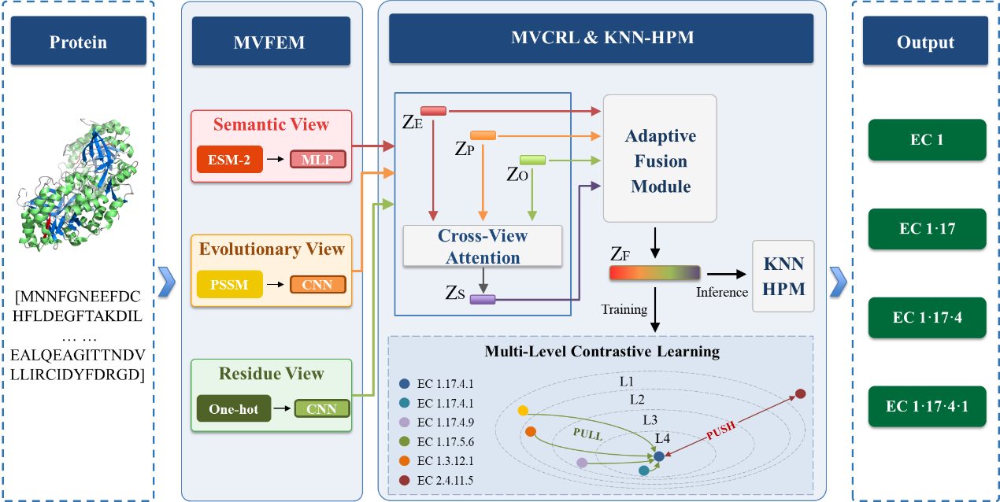
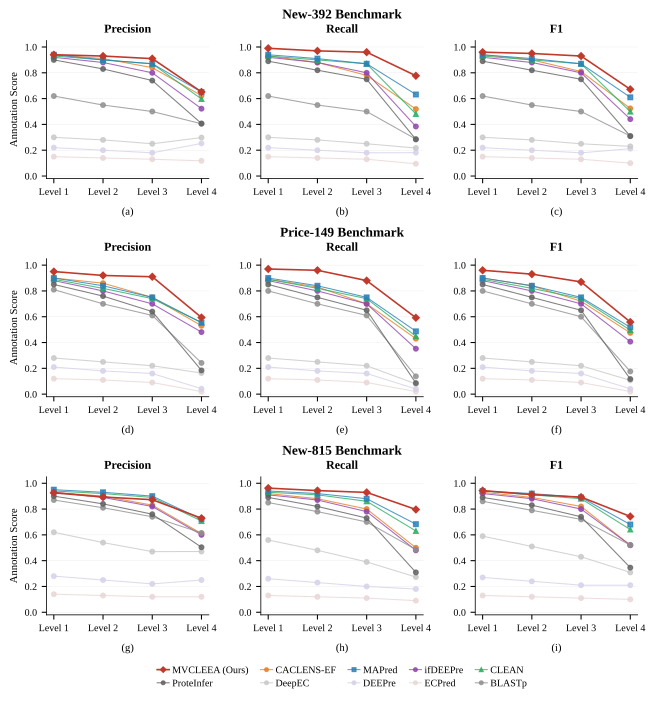
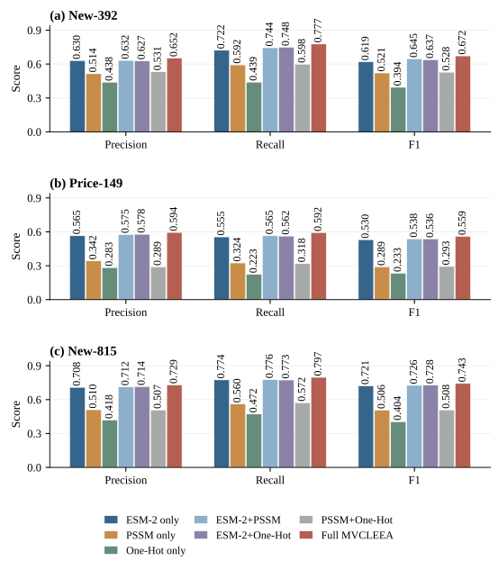
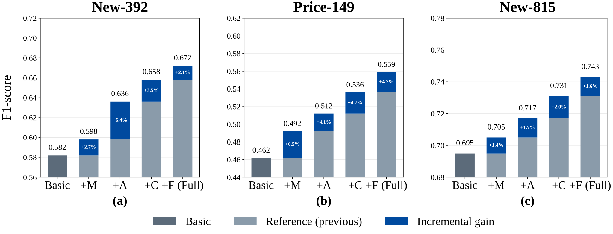
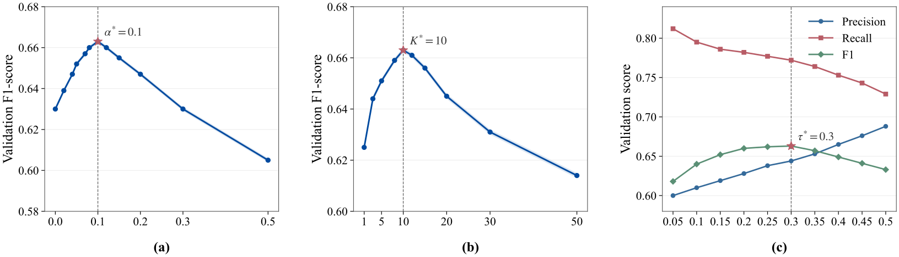

# MVCLEEA

### Multi-View Contrastive Learning for Enzyme Function Prediction

MVCLEEA combines **ESM-2 semantic features**, **PSSM evolutionary profiles**, and **one-hot residue identities** to predict Enzyme Commission (EC) numbers from protein sequences. Global-token cross-view attention and adaptive fusion integrate the three views. Hierarchical multilabel contrastive learning shapes a functional embedding space, and cosine KNN voting assigns complete EC annotations.

This repository includes the method implementation, feature-extraction code, and three external evaluation datasets from the paper.

[Framework](#framework) | [Experiments](#experiments) | [Installation](#installation) | [Datasets](#datasets) | [Usage](#usage)

## Framework

<p align="center">
  <a href="docs/assets/mvcleea_framework.png"></a>
</p>

*Figure 1. MVCLEEA architecture, extracted from the paper.*

- **MVFEM** encodes semantic, evolutionary, and residue views into 256-dimensional representations.
- **MVCRL** learns a consensus through cross-view attention, combines it with the individual views, and produces a 128-dimensional embedding using hierarchical multilabel supervision and ESM-guided alignment.
- **KNN-HPM** retrieves functional neighbors and predicts complete EC labels through similarity-weighted voting. Coarser EC predictions follow their label prefixes.

See the [method outline](docs/METHOD.md) for the learning objective.

## Experiments

### Hierarchical prediction

<p align="center">
  <a href="docs/assets/mvcleea_hierarchical.svg"></a>
</p>

*Figure 2. Precision, Recall, and F1 across EC levels L1-L4 for MVCLEEA and nine baselines.*

The paper reports Level 4 F1 scores of **0.672**, **0.559**, and **0.743** on New-392, Price-149, and New-815. Metrics use category-frequency-weighted averaging.

### Feature ablation

<p align="center">
  <a href="docs/assets/mvcleea_feature_ablation.svg"></a>
</p>

*Figure 3. Seven feature configurations on the three test sets, comparing individual views, view pairs, and the complete three-view model.*

### Structural ablation

<p align="center">
  <a href="docs/assets/mvcleea_structural_ablation.svg"></a>
</p>

*Figure 4. Stepwise additions of padding masks (M), ESM-guided alignment (A), cross-view attention (C), and adaptive fusion (F). Gains are relative to the preceding configuration.*

### Parameter analysis

<p align="center">
  <a href="docs/assets/mvcleea_parameters.svg"></a>
</p>

*Figure 5. Validation-set analysis of alignment weight, neighbor count, and voting threshold. The selected settings are `alpha = 0.1`, `K = 10`, and `threshold = 0.3`.*

All figures above are original images extracted from the manuscript. Click a figure to view it at full size.

## Installation

Reference environment: Python 3.10, PyTorch 2.5.1, CUDA 12.1, and NVIDIA RTX 3090. Commands use Bash and run from the repository root.

```bash
git clone https://github.com/AGI-FBHC/MVCLEEA.git
cd MVCLEEA
conda create -n mvcleea python=3.10 -y
conda activate mvcleea
pip install torch==2.5.1 --index-url https://download.pytorch.org/whl/cu121
pip install -r requirements.txt
```

ESM-2 extraction requires a CUDA GPU. PSSM extraction requires NCBI BLAST+ and a protein BLAST database; record their versions for reproducibility.

## Datasets

- [New-392](data/datasets/new.csv): 392 proteins, 177 complete EC categories.
- [Price-149](data/datasets/price.csv): 149 proteins, 56 complete EC categories.
- [New-815](data/datasets/new-815.csv): 815 proteins, 380 complete EC categories.

Files are TAB-separated with `Entry`, `EC number`, and `Sequence` columns. Multiple EC labels use semicolons. See [dataset sources and checksums](data/README.md).

Prepare training and validation tables separately. The paper uses a 5% validation holdout for parameter selection and reserves the three external test sets for final evaluation.

## Usage

### Feature extraction

The three feature views have shapes `1280` (ESM-2), `1024 x 20` (PSSM), and `1024 x 21` (one-hot) per protein.

```bash
python src/extract_esm2.py --data_dir data/datasets --datasets new price new-815 --gpu 0
python src/extract_pssm.py --datasets new price new-815 \
  --psiblast /path/to/psiblast --blast_db /path/to/protein_database
python src/extract_onehot.py --datasets new price new-815
```

Outputs go to `data/features/`. Prepare the same features for your training table; detailed commands and ID-mapping conventions are in the [usage guide](docs/USAGE.md#feature-extraction).

### Train

Place your training table at `data/splits/train.csv` and copy the included test tables into the same directory:

```bash
mkdir -p data/splits
cp data/datasets/*.csv data/splits/
python src/train.py --train_data train --test_data new \
  --epochs 100 --batch_size 128 --gpu 0 --seed 42 \
  --experiment_name mvcleea_seed42 --retrain
```

The script saves weights to `models/mvcleea_seed42.pth` and metrics to `results/mvcleea_seed42.json`.

### Evaluate

```bash
python src/train.py --train_data train --test_data new \
  --experiment_name mvcleea_seed42 --gpu 0
```

Use an existing checkpoint; the entry point starts training if it is missing. Change `--test_data` to `price` or `new-815` for the other datasets, preserving the result JSON between evaluations.

See the [usage guide](docs/USAGE.md) for workspace layout, paper-protocol notes, and ablation options. Training tables, generated features, checkpoints, and run outputs remain outside Git.

## Paper

**Multi-View Contrastive Learning for Enzyme Function Prediction**

Jie Ge, Haijun Shi, Zhihao Liu, Guanjin Wang, Zhaohong Deng, and Hailong Yang.

We use ESM-2 for semantic features and acknowledge [CLEAN](https://github.com/tttianhao/CLEAN) and [MAPred](https://github.com/Rongdingyi/MAPred) for the benchmark data.
